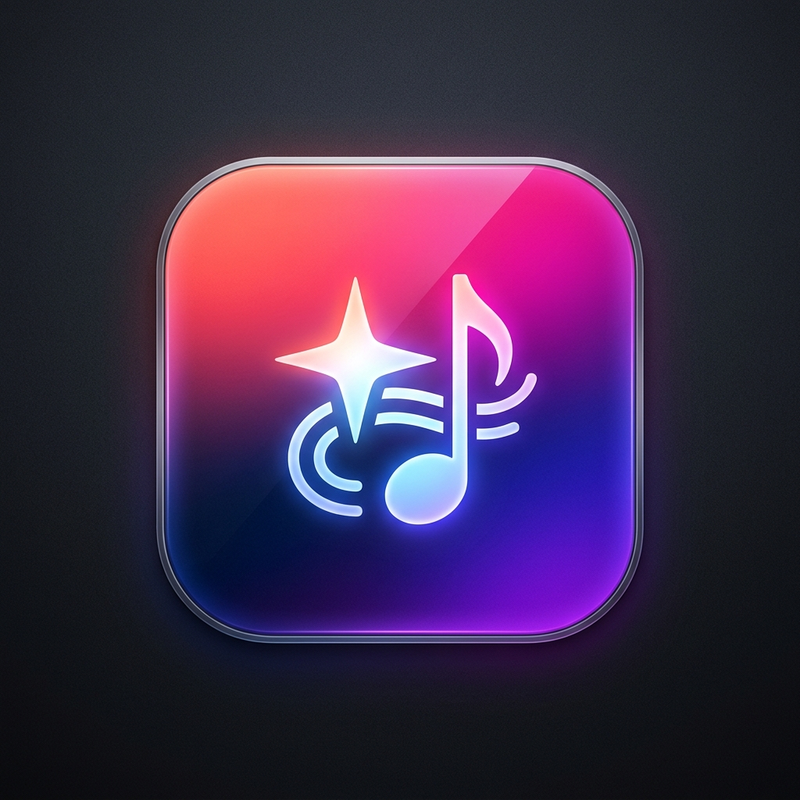
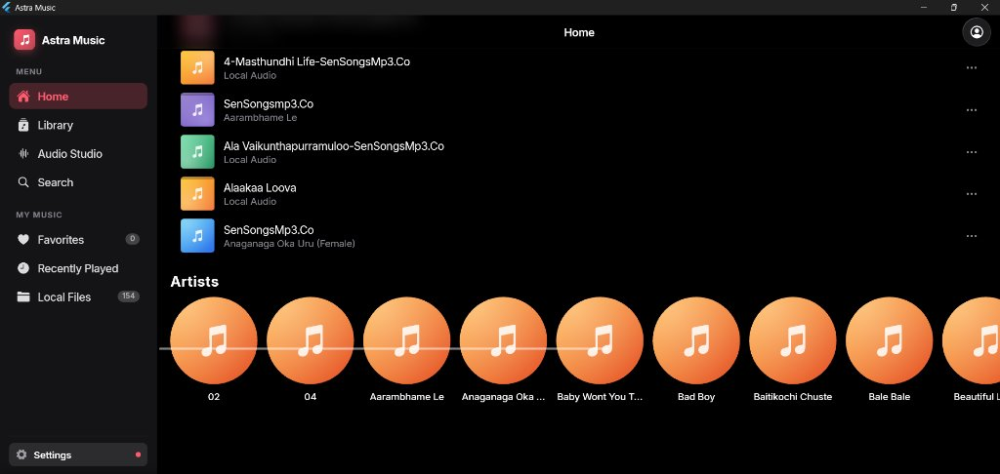
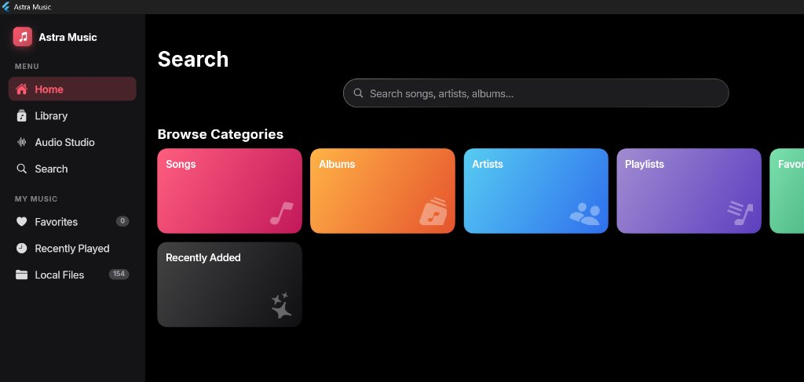
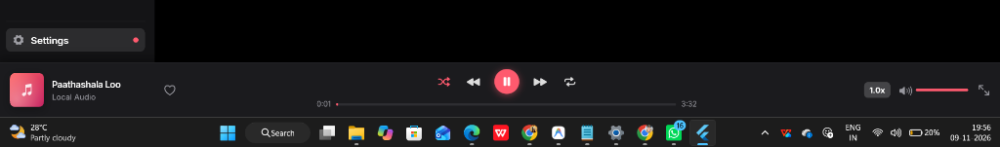

<p align="center">
  
</p>

# Astra Windows Music App 🎵

[](https://flutter.dev)
[](https://microsoft.com/windows)
[]()
[]()

A high-performance, offline-first native Windows desktop music player and audio suite built with Flutter. Features a Liquid Glass design language, native ID3v2 & FLAC embedded album art extraction, responsive sidebar navigation, persistent audio dock, and an interactive audio studio.

---

## 📸 Screenshots

| Home & Local Library | Search & Categories |
|:---:|:---:|
|  |  |

### Desktop Player Dock


---

## ✨ Features

- **Desktop-Optimized Responsive Layout**:
  - **Sidebar Navigation**: Instant switching between Home, Library, Audio Studio, and Search with reactive active indicators.
  - **Persistent Bottom Player Dock**: Dedicated transport controls, live interactive seekbar, volume slider, shuffle/repeat toggles, and instant favorite hearts.
  - **Full-Screen Now Playing View**: Smooth modal transition with dynamic ambient background glow extracted in real-time from the currently playing album art.

- **Embedded Album Art & Metadata Engine**:
  - Pure-Dart low-latency parser supporting:
    - **MP3**: ID3v2.2, ID3v2.3, and ID3v2.4 `APIC` frames (JPEG, PNG, WebP, GIF).
    - **FLAC**: `METADATA_BLOCK_PICTURE` (type 6).
    - **MP4 / M4A / AAC**: `covr` atom extraction.
    - **Directory Art Fallbacks**: Automated discovery of `cover.jpg`, `folder.jpg`, etc.
  - Automatic tag sanitization and real artist/title resolution (*e.g., separating artist credits from file name web tags*).
  - Adaptive fallback: Generates elegant dynamic gradient tiles for tracks without embedded artwork.

- **Audio Studio & Equalizer**:
  - Live playback speed adjustment (0.5x to 2.0x).
  - Pitch shifting and sound adjustment suite.
  - Local stem generation and studio presets.

- **Smart Offline Library**:
  - Fast background scanning of Windows Music directories (`%USERPROFILE%\Music`).
  - Generated smart mixes (*Shuffle All*, *New Music Mix*, *Favorites Mix*).
  - Instant fuzzy search across titles, artists, and albums.

---

## 🛠️ Technology Stack

- **Framework**: [Flutter Desktop (Windows)](https://flutter.dev/desktop)
- **Language**: Dart 3
- **Audio Playback**: `audioplayers` with native Windows DirectShow / Media Foundation bindings
- **State Management**: Reactive `ChangeNotifier` + `ListenableBuilder` architecture
- **Design Tokens**: Astra Liquid Glass Design System with Cupertino iconography

---

## 🚀 Getting Started

### Prerequisites

- Windows 10 (version 1809 or higher) or Windows 11
- [Flutter SDK](https://flutter.dev/docs/get-started/install/windows) (version 3.13 or later)
- [Visual Studio 2022](https://visualstudio.microsoft.com/) with "Desktop development with C++" workload installed
- Git

### Installation & Run

1. **Clone the repository**:
   ```bash
   git clone https://github.com/SriRamKunamsetty/Astra-Windows-Music-App.git
   cd Astra-Windows-Music-App
   ```

2. **Fetch dependencies**:
   ```bash
   flutter pub get
   ```

3. **Run in Debug mode**:
   ```bash
   flutter run -d windows
   ```

4. **Build Release Executable**:
   ```bash
   flutter build windows --release
   ```
   The self-contained executable and dependencies will be generated in `build/windows/x64/runner/Release/`.

---

## 📂 Project Architecture

```
windows app/
├── assets/
│   ├── fonts/               # Inter typography
│   └── samples/             # Bundled demo audio
├── lib/
│   ├── audio/               # Audio engine & player controller
│   ├── data/                # Library repository, track models, artwork cache
│   ├── platform/            # Native Windows integration & audio tag reader
│   │   ├── audio_tag_reader.dart  # Pure-Dart ID3/FLAC/M4A parser
│   │   └── native_media.dart      # Platform interface
│   ├── theme/               # Astra Liquid Glass design tokens
│   ├── ui/                  # Desktop shell, screens, and components
│   │   ├── now_playing/     # Now playing view with dynamic ambient glow
│   │   ├── screens/         # Home, Library, Studio, Search screens
│   │   ├── shell.dart       # Responsive desktop sidebar & bottom player bar
│   │   └── widgets/         # TrackArt, buttons, glass containers
│   └── main.dart            # Desktop entrypoint & custom scroll behavior
├── screenshots/             # App preview images
└── pubspec.yaml             # Project dependencies & metadata
```

---

## 👥 Contributors

- **Mohan Sri Ram Kunamsetty** - [@SriRamKunamsetty](https://github.com/SriRamKunamsetty)
  - GitHub: [https://github.com/SriRamKunamsetty](https://github.com/SriRamKunamsetty)
  - Email: mohansriramkunamsetty@gmail.com

---

## 📄 License

This project is licensed under the MIT License - see the LICENSE file for details.
